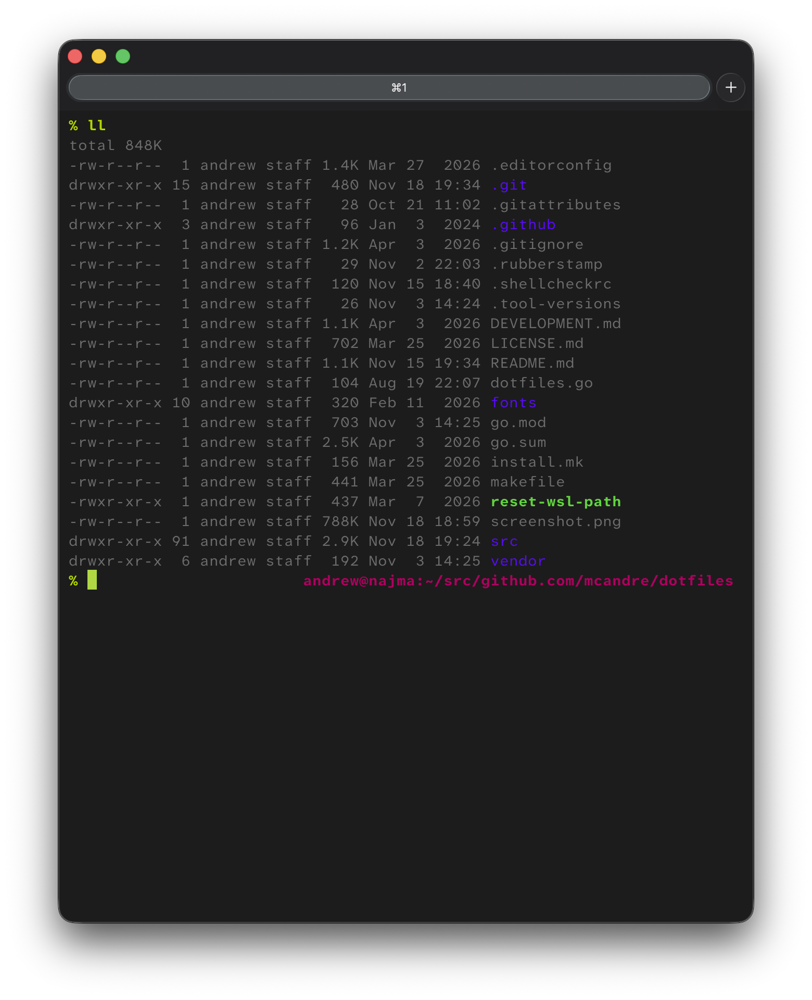

# dotfiles: configuration files

  

# ABOUT

Collection of configurations for safe, fast, software development.

# REQUIREMENTS

* a UNIX-like environment (e.g. [WSL](https://learn.microsoft.com/en-us/windows/wsl/))
* [asdf](https://asdf-vm.com/)
* [awk](https://pubs.opengroup.org/onlinepubs/9799919799/utilities/awk.html)
* [findutils](https://pubs.opengroup.org/onlinepubs/9799919799/utilities/find.html)

## Recommended

* [lessutils](https://www.greenwoodsoftware.com/less/)
* [mcandre/kickers](https://github.com/mcandre/kickers)

For details on building from source, see [DEVELOPMENT](DEVELOPMENT.md).

# WINDOWS TERMINAL

`~\AppData\Local\Packages\Microsoft.WindowsTerminal_8wekyb3d8bbwe\LocalState\settings.json`
